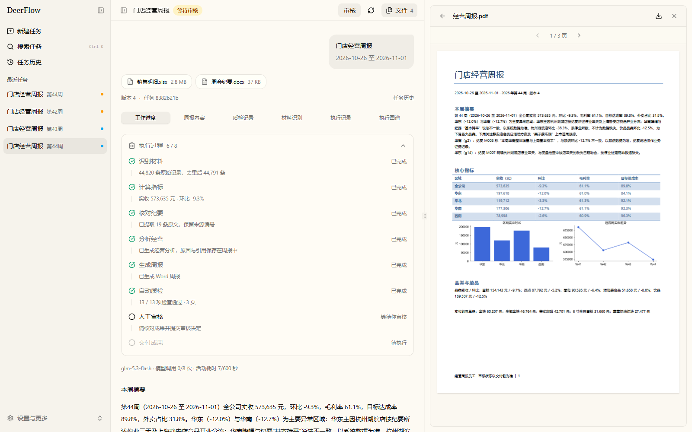

# 经营周报员工

场景 A 的本地工作流型数字员工。复用开源项目的流程与前端组件，使用 LangGraph 编排、Agent Skills 岗位配置、MCP 官方 SDK 工具和 docxtpl 模板，生成可审核交付的 Word 周报。来源、许可证和改动见 [开源复用记录](THIRD_PARTY_NOTICES.md)。

## 启动

Windows 需要 Python 3.11+、Node.js 22.12+、Microsoft Word（用于真实页数与 PDF 预览检查）。运行 `start.bat`；首次安装需要网络。浏览器访问 http://127.0.0.1:8501 。

`.env` 保存在后端，已有模型连接会沿用；可在侧栏底部“设置与更多 → 模型连接与调试”修改，密钥不回传浏览器。公开示例在 `.env.example`，不得提交真实 `.env`。

界面基于 [DeerFlow e0f5483（MIT）](https://github.com/bytedance/deer-flow/tree/e0f5483fdf4466c3c9b3d19d01f6c7e6f4ed641f) 适配：直接复用主题、响应式侧栏、Radix 组件、分屏、文件卡片、执行步骤与设置弹窗。左侧最近任务，中间实际执行过程与人工审核，右侧真实成果；窄屏使用抽屉预览。React 19、Tailwind 4；本地接口继续运行原LangGraph业务，不使用上游模拟案例。



```powershell
python -m venv .venv
.\.venv\Scripts\python.exe -m pip install -r requirements.lock.txt
.\.venv\Scripts\python.exe -m pip install --no-deps -e .
npm.cmd ci --prefix frontend
npm.cmd run build --prefix frontend
.\.venv\Scripts\python.exe -m uvicorn report_agent.api:app --host 127.0.0.1 --port 8501
```

## 完成一次任务

1. 新建任务，选择 ISO 年/周，上传销售 Excel/CSV 与对应周纪要。支持多表 Excel；CSV 的门店、商品、目标来自配置的基础资料，也可额外上传工作簿。默认基础资料来自企业场景 A 数据包，无内置销售演示任务。
2. 程序识别材料、按记录ID剔除相同重复上传、关联基础表，再计算实收、毛利率、目标达成率、外卖占比、前五单品及异常；冲突ID、无可用上期、缺材料等暂停并说明原因。
3. 模型逐项分析超过阈值的区域、门店；Word 由业务模板生成，至少两张图表。程序检查结构、数字、证据、异常覆盖、图表、行动项、文件摘要和 Word 实际页数。
4. 质检通过后下载草稿及排版预览，填写审核人，选择通过或退回修改。退回意见进入同任务下一版本，重新质检、重新送审。
5. 当前版本通过人工审核后，下载包含正式 Word、质检、审核、完整原文、指标来源、配置与执行记录的 ZIP 交付包。

缺材料、工具故障、限流或超限会保存进度；只有明确操作才恢复。超限必须填处理人和处理意见。服务重启后从“任务历史”打开任务，从持久检查点继续；已完成的工具通过任务和参数缓存复用，不承诺外部副作用严格一次执行。

## 业务配置

- `skills/weekly-report/SKILL.md`：岗位职责、工作步骤、注意事项与写作要求。
- `config/employee.yaml`：工具许可、模型预算、阈值、质检、限制理由。
- `config/columns.yaml`：销售字段和基础表别名。
- `config/reference/*.csv`：企业提供的基础资料，仅用于赛事配置；不含销售流水。
- `templates/weekly-report.docx`：首次生成后可用 Word 编辑的 docxtpl 模板。

侧栏底部“设置与更多 → 员工配置”可以修改文本配置，“执行限制与人工处理”展示限制值及理由。新任务保存创建时快照，已有任务保持原岗位配置。流程权限、非法状态拒绝和审核校验由程序执行。

## 验证

将 `PUBLIC_DATA_DIR` 指向企业场景 A 解压目录，然后运行：

```powershell
.\.venv\Scripts\python.exe -m pytest -q
.\.venv\Scripts\ruff.exe check report_agent tests
.\eval.ps1
npm.cmd test --prefix frontend -- --maxWorkers=1
```

pytest 的模型替身仅位于 `tests/`，不在产品入口提供演示或自动审批。真实模型运行、工程回归、企业判定点必须分别报告，详见 `docs/verification.md`。完整赛事验收还需人工审阅、企业盲测及现场变更。

服务启动后，可运行 `.\.venv\Scripts\python.exe scripts/check_ui.py`，以本机 Edge 和 Chrome 检查 375/760/1024/1600px 布局、真实任务各页签、PDF翻页、面板拖拽恢复、分屏切换、提示关闭、搜索与设置。双文件上传验证拦截写入，不创建产品任务或提交审核；二进制上传另外通过隔离接口测试。截图和结果保存在 `runtime/ui-qa/deerflow/`。
