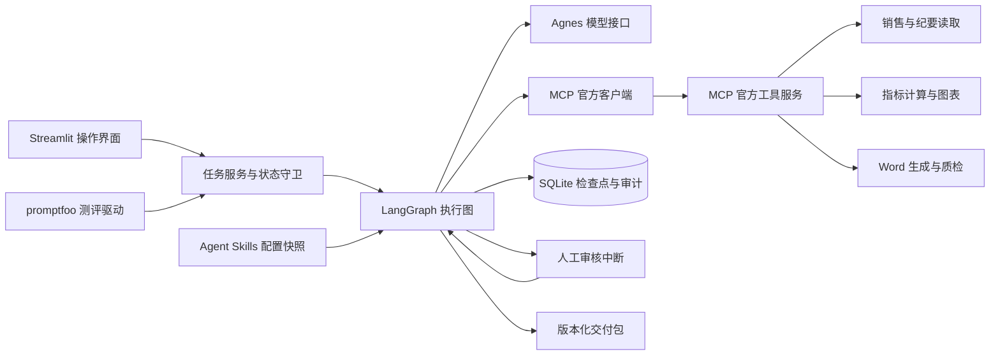

# 经营周报员工技术报告

本项目实现赛题场景 A，重点支持场景一的正常生成、自动质检修正、人工退回和最终交付，同时实现缺材料暂停、工具故障重试、事件记录与检查点恢复。

## 架构与职责

LangGraph 负责状态编排；Agent Skills 提供可读的岗位知识；MCP 提供结构化工具调用；模型只进行证据驱动的文字生成；程序判断能否进入审核和交付。首版固定工作流可减少模型工具选择错误，保留替换模型和增加工具的接口。

## 状态流转表

| 当前状态 | 触发条件 | 下一状态 | 控制主体 |
|---|---|---|---|
| NEW | 开始执行、准入通过 | RUNNING | 程序 |
| NEW / RUNNING | 材料缺失、输入无效、故障或超限 | PAUSED | 程序 |
| RUNNING | 自动质检失败且未达修正上限 | RUNNING | 程序 |
| RUNNING | 自动质检全部通过 | REVIEW | 程序 |
| REVIEW | 审核人退回并填写意见 | REWORK | 人工决定，程序校验 |
| REWORK | 新版本开始撰写 | RUNNING | 程序 |
| REVIEW | 当前版本通过且内容摘要匹配 | APPROVED | 人工决定，程序校验 |
| APPROVED | 交付文件校验及打包成功 | DELIVERED | 程序 |
| APPROVED | 交付失败 | PAUSED | 程序 |
| PAUSED | 人工恢复，未替换材料 | RUNNING / APPROVED | 回到记录的失败步骤 |
| PAUSED | 人工补充或替换材料 | RUNNING | 重新准入并重算受影响内容 |
| DELIVERED | 重复执行 | DELIVERED | 幂等返回 |

未处于 REVIEW 时审核、审核旧版本、未暂停时恢复等非法操作被拒绝并记入事件日志。审核界面不提供绕过质检的入口。

## 员工技能配置

`skills/weekly-report/SKILL.md` 包含符合 Agent Skills 格式的 YAML 元信息与 Markdown 指令，岗位名与目录名一致。参考资料位于 `references/`，报告说明位于 `assets/`。运行时加载技能、字段映射、质检规则和限制，保存任务快照与 SHA-256 摘要。

`config/employee.yaml` 是应用运行配置，不声称其扩展字段属于 Agent Skills 标准。工具许可由应用白名单与员工配置取交集，不能依赖模型自觉遵守。职责、提示、阈值、字段别名可改配置；新增状态或新工具实现需改代码。

## MCP 工具契约

工具服务使用 `mcp.server.fastmcp.FastMCP`，它来自官方 `mcp` 包，并非另外安装的第三方 `fastmcp` 包。客户端通过官方 `ClientSession` 与 stdio 通信。MCP 会话在独立异步任务内建立和退出，避免不同 LangGraph 节点关闭同一 AnyIO 上下文造成错误。

| 工具 | 主要输入 | 成功输出 |
|---|---|---|
| read_sales | task_id、任务内文件路径、列名映射 | records、warnings、row_count；金额为整数分 |
| read_minutes | task_id、任务内文件路径 | sources，每条包含稳定编号与原文 |
| compute_metrics | 销售 records、任务周期、异常阈值 | total、groups、tokens、warnings、比较周期 |
| render_charts | task_id、artifact_id、metrics | 图表相对路径 file |
| build_report | 指标、纪要、草稿、图表、版本及反馈 | Word 相对路径 file |
| inspect_report | Word、草稿、指标、纪要、质检规则 | passed、checks、质检记录相对路径 |

每个工具通过 MCP 发布 JSON Schema。统一结果包含 `ok`、成功时的 `data`，或失败时的 `error` 和 `kind`。材料问题直接提示补充，临时执行故障按限制重试。

所有路径必须处于当前任务目录，上传文件使用内容摘要命名，阻止目录穿越。MCP 进程不接收 API 密钥。确定路径和原子写入避免文件重试时产生多个逻辑副本；成功工具结果在 SQLite 中缓存。

## 业务计算与证据

金额先转为整数分，使用确定性计算汇总并生成同一份指标映射，正文通过占位符引用。环比采用本期与上期差额除以上期绝对值；上期为零、上期缺数据分开显示。分区域、门店、品类的汇总表与图表共享计算结果。

模型输出经 Pydantic 约束，纪要原文按段编号。确定原因至少需要来源与原文片段；缺证据必须标记待核实。质检验证引用存在和摘录匹配，人工判断证据与结论是否充分相关。纪要内容被视为数据，不能改变程序权限或审批规则。

## 质检和预算

质检记录包含章节、正文字符数、未解析指标与未引用数字、表格数值、证据原文、图表、禁用词和反馈响应。每次检查结果保存到版本目录和任务历史。失败最多返工两轮，之后暂停转人工。

默认每轮十二次模型请求、每次六十秒、活动执行六百秒、工具重试两次、模型错误重试两次。这个范围允许初稿及有限返工，并防止免费服务异常导致无限等待。人工等待不计入执行时间；恢复与审核退回启动新一轮预算。

每个模型请求在调用前持久化事件，重启后该请求仍消耗预算。活动耗时在步骤完成时累计，硬退出的未完成步骤耗时可能无法恢复；真实生产部署需持久化租约或独立任务调度器进一步完善。

## 审核和恢复

审核通过绑定报告版本和文件摘要。退回保存意见，增加版本，将原稿和意见一同送入模型，之后再次生成与质检。正式交付不接受模型自行判断的“通过”。

LangGraph 将状态写入本地 SQLite。暂停节点仅等待 `interrupt`，不在其中执行文件写入等外部副作用；审核恢复使用 `Command(resume=...)`。读数、分析和图表各自是节点，已提交检查点不重跑。外部操作完成与本地记账间仍有崩溃窗口，因此采用幂等写入与工具结果缓存降低重放影响，不声称分布式严格一次执行。

## 验证与复现

安装、运行、测试命令见 README。promptfoo 通过 Python Provider 调用应用服务，记录最终状态、金额、环比、质检、审核版本和工具事件，而非只测单条提示词。离线替身用于稳定测试工程路径；真实模型测评单独报告，不混合成功率。

测试覆盖正常执行、金额边界、缺材料、错误输入、审核退回、故障重试、进程直接退出后恢复、调用越权、文件改动与界面操作。验证结果见 verification.md。企业公开样例与盲测需要企业输入后另行验证。

## 官方参考

- [LangGraph 人工中断](https://docs.langchain.com/oss/python/langgraph/interrupts)
- [LangGraph 持久化](https://docs.langchain.com/oss/python/langgraph/persistence)
- [Agent Skills 规范](https://agentskills.io/specification)
- [MCP Python 官方 SDK](https://github.com/modelcontextprotocol/python-sdk)
- [promptfoo Python Provider](https://www.promptfoo.dev/docs/providers/python/)

本报告为 Markdown 源文档，尚未排版为提交用八页以内 PDF。
