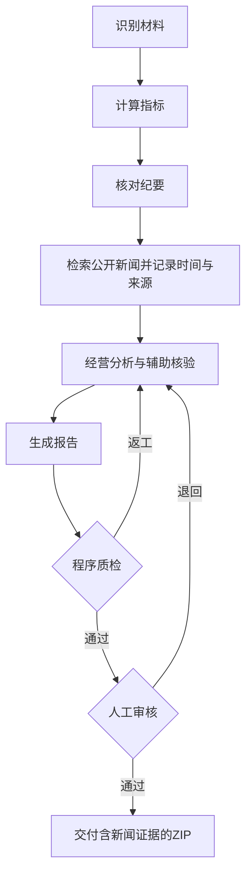

> 2026-11-07：新增新闻节点，主流程与执行图谱已同步更新。新闻失败显示未核实，不把未找到结果当作纪要错误。

# 经营周报员工参赛流程与实现对照

经营周报员工接收统计周期、销售明细和周会纪要，完成材料校验、常规经营分析、异常解释及 Word 生成；程序质检通过后进入人工审核，审核通过当前版本后正式交付。缺材料、工具多次失败或执行超限时，保存进度并等待人工处理。

三张图均对应当前代码：主流程、公共异常恢复和定向返工。业务步骤的拆分用于解释工作内容，不代表每个框都对应独立 LangGraph 节点；新增 `rework` 节点负责问题归类和受控路由。

## 当前主流程

[可编辑 Mermaid 源文件](diagrams/weekly-report-current.mmd)

主图集中展示正常执行、自动修正及人工退回。各步骤的缺材料、故障、超限与恢复分支统一见下方公共异常图，避免跨越整张主图的长连线。

准入检查目前分布在表单、`ingest`、`calculate` 和 `evidence` 中，全部位于模型分析之前。常规分析和异常定位同属 `calculate`，纪要读取在计算之后顺序执行。当前代码没有独立的规划器、并行分析分支或独立模型复核节点。

| 业务环节 | 当前实现 | 校验或产出 |
|---|---|---|
| 发起与冻结配置 | `TaskSpec`、`Service.create` | 校验 ISO 年周、名称；记录任务及配置快照。非法表单或不支持的文件直接拒绝 |
| 销售材料准入 | `ingest` → `read_sales` | 预检 Office 解压规模与工作表行列数；严格解析日期，拒绝歧义格式并报告行号；检查必需字段、基础资料和关联关系；清理同 ID 且内容一致的重复记录 |
| 周期与指标准入 | `calculate` → `compute_metrics` | 检查本期、上期及目标数据；无本期数据时提示上传资料的实际日期范围 |
| 常规经营分析 | `compute_metrics` | 公司和区域实收、环比、毛利率、目标达成率、外卖占比；品类实收与环比、前五单品、趋势 |
| 异常定位 | `compute_metrics` | 用未舍入的分/比例判断区域、门店实收环比是否超过配置阈值（默认 ±10%），并判断区域品类毛利率下降；一位小数仅用于展示 |
| 纪要准入与整理 | `evidence` → `read_minutes` | 要求可确认的 ISO 年周或完整周一至周日日期范围；标题与统计周期冲突或与任务不一致时暂停；Word 按正文顺序读取并保留来源编号 |
| 原因解释与写作 | `analyze` → `generate` | 模型结合程序指标、纪要、质检问题和审核意见生成结构化草稿；无依据的原因标为待核实 |
| 成果生成 | `render` → `generate_report` | 用程序指标填充 Word，生成图表，保存草稿、来源和文件摘要 |
| 自动质检 | `quality` → `inspect_report`、`page_inspection` | 检查内容与实际文件，程序汇总 `passed` 后决定是否进入审核 |
| 人工审核 | `human_review` → `rework` | 必须由人提交通过或退回；意见逐项登记，创建新版本并按问题类别返工，保留未受影响的结果 |
| 定向返工 | `rework`、`rework.py` | 配置决定问题类别和章节，程序选择最早受影响节点；多类问题合并处理。数据口径问题暂停请求材料，不能无依据修改指标 |
| 正式交付 | `finalize` | 再次核对质检、批准版本及文件摘要；打包 Word、质检、审核、配置、来源和事件记录 |

第 46 周请求而文件只覆盖到第 44 周时，程序在指标计算前暂停并提示实际覆盖范围，不会进入模型写作。纪要没有可确认周期、仅有无年份周次、完整日期范围与标题冲突时，均暂停补充材料。

## 公共异常处理与恢复

[可编辑 Mermaid 源文件](diagrams/weekly-report-recovery.mmd)

| 情况 | 当前处理 | 恢复条件 |
|---|---|---|
| 缺材料、字段歧义、缺本期或上期数据、缺目标 | 直接暂停并说明具体问题，不盲目重试 | 在同一任务补材料或修正参数后重新导入并校验 |
| 节点内工具临时失败 | 首次调用后最多重试 2 次；仍失败则暂停 | 故障处理后从保存的失败步骤继续 |
| 模型网络或一般服务错误 | 有限重试，实际请求均计入预算；仍失败则暂停 | 故障处理后明确恢复 |
| 模型限流、配置错误或输出截断 | 暂停并提示原因 | 处理服务或配置问题后恢复 |
| 模型单次超时、调用次数或活动时间超限 | 暂停并停止自动调用 | 填写处理人和处理意见后明确恢复，产生新的预算编号并保留历史记录 |
| 自动质检修正耗尽 | 最多 2 轮修正后仍失败则暂停 | 人工核实后恢复；也可对已有草稿显式复检 |
| 审核状态、版本或文件摘要不符 | 程序拒绝审核或交付；服务层拒绝记录进入事件日志 | 重新核对当前版本，必要时退回生成并重新审核 |
| 执行进程中断 | 已提交检查点与事件保留 | 服务重启后由用户明确恢复可运行任务，已完成工具结果可命中缓存 |

MCP 初次连接已纳入保护：官方 SDK 连接上下文由服务父任务管理，最多三次尝试；连接失败作为受控工具错误交给图节点保存检查点并暂停。连接耗时计入活动预算，握手与工具发现有超时限制。故障解除后可由新的服务实例恢复同一任务。进程被强制终止等无法执行清理的情况仍依靠持久检查点和明确恢复。

替换销售、基础资料或字段映射返回 `ingest`；只修改周次返回 `calculate` 并复用销售解析；只替换纪要返回 `evidence` 并保留销售与指标。材料变化撤销旧批准和下游成果。生成与检查文件不使用存在性缓存，防止篡改后复用通过结果；纯数据工具继续缓存。写文件和检查点提交之间仍有崩溃窗口，不宣称严格一次执行。

## 状态流转与程序控制

| 当前状态 | 触发及必要条件 | 下一状态 | 程序行为 |
|---|---|---|---|
| `pending` 待执行 | 材料导入成功 | `running` 执行中 | 开始后续步骤并记录事件 |
| `pending` 或 `running` | 受控执行异常、缺材料、超限 | `paused` 已暂停 | 保存恢复节点和具体原因 |
| `running` | 质检失败且尚可修正 | `running` | 增加修正计数与版本，携带问题返回 `rework`，再按类别选择节点 |
| `running` | 修正额度已用完仍不合格 | `paused` | 停止自动修正，转人工处理 |
| `running` | 程序判定全部质检通过 | `awaiting_human` 待审核 | 调用 `interrupt`，等待人工决定 |
| `awaiting_human` | 当前版本退回，审核人及意见有效 | `running` | 逐项记录意见、新建版本、清除批准，返回 `rework` |
| `awaiting_human` | 当前版本通过，质检及文件校验有效 | `approved` 已批准 | 批准绑定当前版本和 SHA-256，进入 `finalize` |
| `approved` | 交付前校验通过且打包成功 | `completed` 已交付 | 生成正式交付包 |
| `approved` | 打包故障或批准文件不一致 | `paused` | 保留失败信息；文件不一致时不得直接交付 |
| `paused` | 人工明确恢复，必要材料和处理信息已提交 | `running`，或继续交付时为 `approved` | 回到保存步骤；材料有变化则按依赖失效并撤销旧批准 |
| `paused` 或 `awaiting_human` | 有草稿且满足显式复检条件 | `running` | 新版本返回 `render`，复检不调用模型；失败仍暂停 |
| `running` 或 `approved` | 服务重启后明确恢复，且存在待完成检查点 | 原执行状态继续 | 接续持久化检查点，保持任务编号 |

禁止绕过的控制：质检未通过不能送审；非待审核状态或过期版本不能审核；退回意见不能为空；未批准当前版本不能交付；批准后文件变化不能交付；正在执行的任务不能重复启动；预算暂停不能通过不填写处理记录的复检入口绕过。接口和服务层先做校验，图内及交付前再次核对关键条件。模型输出不产生人工批准权限。

`completed` 不接受直接恢复或重复审核。普通恢复不会自行批准成果。人工等待不消耗活动执行时间，新的执行轮次预算与历史调用记录分别保存。

## 场景业务验收

| 业务要求 | 必须达到的行为 | 当前覆盖与边界 |
|---|---|---|
| 常规经营内容完整 | 不超过 5 句摘要；公司及四区域核心指标；品类表现和前五单品；下周关注不超过 5 条 | 程序提供指标并写入模板；摘要句数已有独立检查，可在配置修改上限 |
| 异常逐项解释 | 区域和门店环比超过 ±10% 的异常全部出现 | 程序检查异常 ID 无遗漏、无重复；模型负责解释 |
| 原因有依据 | 引用对应周纪要；没有依据时写“原因待核实” | 已校验来源编号及连续原文；证据是否支持特定门店、时段及结论仍需加强核对 |
| 数据与纪要冲突 | 以数据为准，明确指出不一致 | 当前自动冲突检测覆盖配置中的持平说法；其他冲突不能宣称已全部覆盖 |
| 重复与退货 | 同 ID 且内容一致才剔除重复；负数退货冲减当期 | 已按程序处理并保留记录；同 ID 内容冲突暂停核实 |
| 无记录日 | 区分系统缺失、停业、新店未开业；手工台账单独说明 | 提供无记录日及纪要，技能要求解释；完整分类尚依赖模型和人工，不能一律补零 |
| 文件可交付 | Word 正文不超过 3 页、至少 2 张图表、金额取元、比例一位小数、数字可追溯 | 已生成图表，核对 Word 核心表格、正文数字、文件摘要和实际页数；图表内容一致性可继续增强 |
| 退回意见被采纳 | 同任务修改后送审，说明每条意见对应的修改 | 稳定意见 ID、逐项回应、章节前后差异、来源编号及核验历史已接入质检。漏回应、无实际修改、假来源会阻断送审；语义充分性仍由人确认 |

第 44 周公开用例要求覆盖华东、华南 2 个区域，以及杭州湖滨、上海静安、深圳南山、深圳福田 4 家门店的异常，并指出“华南基本持平”的纪要说法与数据不一致。停业解释与系统缺数应分别处理。

`quality.max_characters=1800` 是当前团队自定的硬检查，不是赛题规定的字数上限。若将其调整为编辑提示，应同时修改配置语义、质检分级和评测；在完成这项修改前，文档及页面仍需如实显示它会阻断送审。赛题的实际页数、图表、数据正确性要求继续作为硬门槛。

## 定向返工实现

[可编辑 Mermaid 源文件](diagrams/weekly-report-rework-proposed.mmd)

返工不回到任务发起。员工配置中的 `rework.categories`、`section_keywords`、`quality_routes` 控制分类和影响章节；审核人也可显式指定类型。多类问题取最早依赖节点和所有受影响章节的并集；模型返回范围外的章节会被程序丢弃，原文保留。旧任务继续使用原配置快照，新配置在新任务生效。

| 返工类型 | 目标返回位置 | 需要失效或保留的结果 |
|---|---|---|
| 销售材料、字段映射或统计口径变化 | 暂停请求材料，再回到准入或计算 | 销售文件变化重新导入；仅周期变化复用销售解析、重算指标；撤销旧批准。尚未实现单门店行级增量计算 |
| 纪要变化、原因解释或引用不足 | 纪要整理和证据核对 | 销售指标可保留；受影响解释、引用、草稿和批准失效 |
| 文字表达或内容缺项 | 对应章节写作 | 保留已核验指标、来源和无关段落 |
| 页数、图表或排版问题 | 文件生成 | 先使用配置的紧凑排版重新生成，不调用模型；再次页数超限才压缩文字。复杂模板重设计仍须人工编辑 Word 模板 |

每条审核意见登记为独立修改项，保留原意见、影响章节、修改前后内容、引用来源、核验结果和每次尝试记录。借用 AgentOps Studio 的增量台账，以稳定 ID 和程序差异验证代替模糊匹配；遗漏意见不视为已解决。文件版式项由程序记录生成参数和实际文件检查结果。页面的“修改台账”展示差异，交付包增加“逐项修改记录.json”。

“程序核验通过”表示回应存在、所列章节确实变化且来源编号有效，不意味着程序证明每条建议充分或因果正确；最终仍必须人工批准。原始指标准确性和文件质检继续独立执行，不能用修改台账代替。

纪要核对后生成任务清单，列出常规指标、逐个异常、纪要冲突和数据质量核对项，页面工作进度中可查看。没有增加独立模型复核或多智能体协作节点。

## 工程要求与实现依据

| 要求 | 当前实现 |
|---|---|
| 岗位配置可读可改 | [SKILL.md](../skills/weekly-report/SKILL.md) 描述职责、步骤及注意事项；[employee.yaml](../config/employee.yaml) 配置工具、限额、阈值和质检；[columns.yaml](../config/columns.yaml) 配置字段别名。新任务冻结配置快照 |
| 至少 3 个受控工具 | 官方 MCP SDK 发布 5 个工具：`read_sales`、`compute_metrics`、`read_minutes`、`generate_report`、`inspect_report`；程序白名单与配置许可取交集，并检查任务路径 |
| 至少 3 类自动质检 | 内容结构与长度、数据及证据一致性、文件与版式等共 15 项检查，新增摘要句数和审核意见逐项回应；任何一项失败都会阻断送审 |
| 调用及时间上限 | 每轮模型最多 8 次实际请求（含失败），单次 90 秒，活动执行总计 600 秒；工具单次 90 秒，最多重试 2 次；质检最多自动修正 2 轮 |
| 限制理由 | 8 次用于初稿、有限修正和故障请求；90 秒避免单次无限等待；600 秒约束整轮资源消耗。超限明确暂停，人工恢复另记预算，不抹去历史消耗 |
| 状态与断点 | LangGraph `StateGraph`、`interrupt` 和 SQLite 检查点；状态守卫、事件记录、工具缓存和文件摘要校验 |
| 评测 | pytest 与 promptfoo 验证工程路径；当前 promptfoo 使用明确标注的模型替身。真实模型的意见采纳和交付可用性需要单独评测及人工确认 |

主要实现位置：[workflow.py](../report_agent/workflow.py)、[service.py](../report_agent/service.py)、[api.py](../report_agent/api.py)、[mcp_client.py](../report_agent/mcp_client.py)、[data_tools.py](../report_agent/data_tools.py)、[documents.py](../report_agent/documents.py)。

赛题依据为工作区相邻的 `赛题/赛题申报_迷你数字员工-锐软科技（深圳）有限公司.docx`，以及场景 A 数据包中的 `周报格式要求.md` 和 `公开样例用例.md`。场景 A 数据包由出题方提供，说明中明确为赛事模拟数据；它与产品内置演示或测试替身不是同一概念。

参赛展示可使用主流程、异常恢复与定向返工三张图，并配套状态流转表。企业盲测、现场工具故障演示和 15 分钟业务变更须分别记录实际结果，不能用流程图或工程回归代替验收结论。

## 图文件编辑与导出

修改 `docs/diagrams/` 中的 Mermaid 源文件后，在项目根目录运行 `powershell -ExecutionPolicy Bypass -File scripts/render_workflow_diagrams.ps1`，生成对应的 SVG 和 PNG。脚本使用固定版本的 Mermaid CLI 和本机无界面浏览器渲染，工具依赖安装在已忽略的 `runtime/workflow-diagrams/`，不进入产品依赖。SVG 适合放大查看或排版，PNG 可直接插入演示材料。
